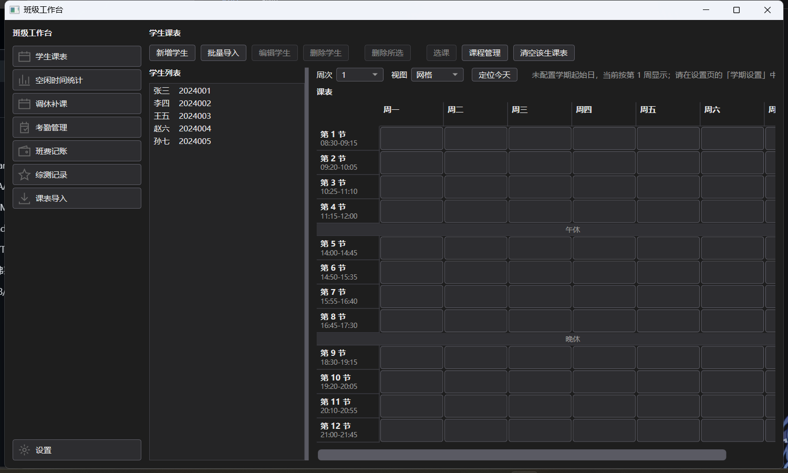

# 班级工作台

> 面向班级的一体化课表与班务管理桌面应用：学生课表、空闲时段统计、考勤、调休补课、班费记账、综测记录、课表批量导入，数据全部存在本机。



## 功能

| 模块 | 说明 |
| --- | --- |
| **学生课表** | 按学生查看个人课表（网格 / 列表两种视图）；学生增删改、选课、批量导入学生、批量删除所选、清空该生课表；「定位今天」按真实星期对齐教学周 |
| **空闲时间统计** | 按学期 + 周次统计全班无课时段，选中格子查看该时段空闲 / 有课两份名单，支持复制与导出 |
| **考勤管理** | 按日期与场合登记出勤 / 迟到 / 旷课 / 请假；名单按课程关联自动带出，课程选择按日期对应；历史考勤与统计汇总 |
| **调休补课** | 放假、停课、补课、调休上课日四类调整；支持批量删除；调整会即时反映到课表与空闲统计 |
| **班费记账** | 收入 / 支出流水、分类统计、余额实时计算（不落库）、导出 Excel |
| **综测记录** | 按类别记分（可为负）、学生汇总交叉表、支持批量删除、导出 Excel |
| **课表导入** | 直接导入教务系统导出的**课表 PDF**（本地解析，不联网），也支持文本；自动按学号或姓名匹配学生，按「课程名 + 教师 + 时段集合」识别开课班，重复导入幂等，导入前自动备份 |
| **数据备份** | 每日首次启动自动备份、破坏性操作前自动备份、手动备份；备份列表可**一键恢复**（恢复前再自动备份当前状态）；自动备份保留最近 20 份，手动备份不清理 |
| **设置** | 学期与起始日（第 1 周周一）、作息时间、主题（深色 / 浅色）、模块显示开关 |

## 技术栈

- **WPF (.NET 8)** + MVVM（CommunityToolkit.Mvvm 源生成器）
- **SQLite** + **EF Core 8**（表结构只走 Migration，共 12 次迁移）
- **ClosedXML**：Excel 导入导出（学生名单 `.xlsx`、统计报表）
- **Docnet.Core**：课表 PDF 解析（内置 PDFium 原生库）
- 依赖注入：`Microsoft.Extensions.DependencyInjection`，`IDbContextFactory` 短生命周期 DbContext

## 快速开始

### 1. 从源码运行

```powershell
git clone <仓库地址>
cd <仓库目录>
dotnet build
dotnet run --project ClassScheduleApp
```

首次运行会自动创建数据库并写入少量演示数据（5 名学生 / 6 门课程），可直接删除后导入自己的名单。

### 2. 生成发布目录

```powershell
dotnet publish ClassScheduleApp\ClassScheduleApp.csproj -c Release -r win-x64 --self-contained true -p:PublishDir=publish\
```

自包含发布，目标机器**无需另装 .NET 运行时**。

### 3. 制作安装包（可选）

需要 [Inno Setup 6](https://jrsoftware.org/isinfo.php)：

```powershell
"C:\Program Files (x86)\Inno Setup 6\ISCC.exe" installer\班级工作台.iss /DSourceDir=publish /DOutputDir=dist
```

脚本 `installer/班级工作台.iss` 只打包程序本体，**不含任何数据**；安装后可自选安装目录，卸载不会删除 `data\`。

## 目录结构

```
ClassScheduleApp/          程序源码
  Data/                    AppDbContext、迁移、种子数据
  Models/                  实体与领域规则（周次 / 单双周 / 当日课程计算）
  Repositories/            数据访问（一律注入 IDbContextFactory）
  Services/                业务服务（学期、作息、调休、备份、导入、导出）
  ViewModels/              MVVM 视图模型
  Views/                   XAML 视图与弹窗
  Themes/                  深色 / 浅色样式
docs/                      验收台账、界面截图
installer/                 Inno Setup 安装脚本
.dsh/skills/               工程规范（架构、MVVM、EF 迁移、构建与自测）
AGENTS.md                  协作规范（最高优先级）
data/                      运行期数据目录（不入库，见下）
```

## 数据与备份

运行期数据全部位于程序目录下的 `data/`（**已被 .gitignore 排除，不会进入仓库**）：

```
data/classschedule.db     学生 / 课程 / 排课 / 考勤 / 综测 / 班费
data/settings.json        主题与模块显示设置
data/backup/              备份（自动 + 手动；设置页可查看、恢复、删除）
data/import-reports/      批量导入学生的逐行报告
```

迁移到其它电脑时，把 `data/` 一起拷走即可带走全部数据。

## 导入格式

- **学生名单**：`.xlsx` 或 `.csv`。表头需含「学号」「姓名」（其余可识别性别 / 班级 / 电话 / 备注）。CSV 自动探测 UTF-8（含 BOM）与 GBK。**以学号为身份键纯增量导入**，已存在的学号跳过、不覆盖既有信息。
- **课表**：教务系统导出的 `.pdf`（解析在本地完成，不联网）或文本格式；自动按学号优先、姓名兜底匹配学生。

## 开发约定

仓库内 `AGENTS.md` 为最高优先级协作规范，`.dsh/skills/` 下四个技能文件分别覆盖：分层与九表结构、WPF/MVVM 写法、EF Core + SQLite 迁移流程、构建与自测要求。`docs/acceptance-ledger.md` 记录各批次的验收项、出处与空证标注。

## 许可

Copyright 2026 徐明哲、Bai

本项目采用 **Apache License 2.0** 开源，全文见 [LICENSE](LICENSE)。

你可以自由使用、修改、分发本项目（包括用于商业目的），只需保留版权声明与许可声明；本项目附带明确的专利授权，但不提供任何担保。详见 LICENSE 与 [NOTICE](NOTICE)。
